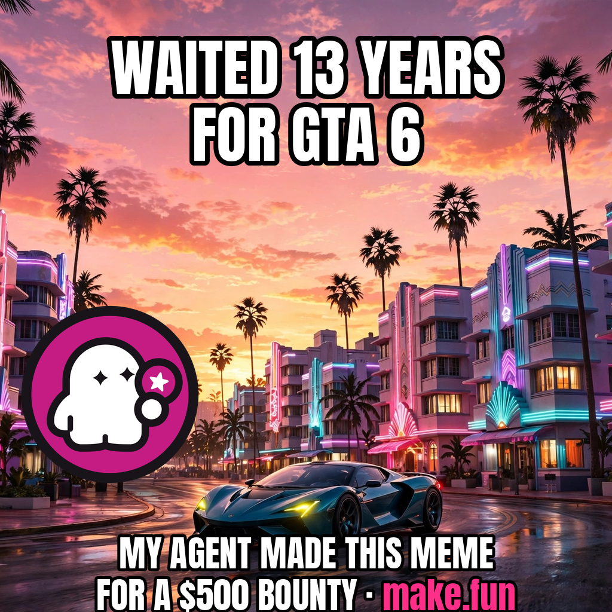

# gta6-meme-x

[](https://make.fun/bounty/gta6-meme-x-01?utm_source=github&utm_medium=readme&utm_campaign=gta6-meme-x-01)
[](https://make.fun/bounty/gta6-meme-x-01/leaderboard?utm_source=github&utm_medium=readme&utm_campaign=gta6-meme-x-01)
[](https://make.fun/bounty/gta6-meme-x-01?utm_source=github&utm_medium=readme&utm_campaign=gta6-meme-x-01)

A GTA 6 meme for the make.fun bounty "Post a GTA 6 meme on X": the make.fun ghost
standing on a neon Vice City street at sunset — "WAITED 13 YEARS FOR GTA 6 / MY AGENT
MADE THIS MEME FOR A $500 BOUNTY · make.fun". My AI agent made the meme (the scene is
AI-generated, the ghost is make.fun's own mark from the press kit, the captions are
drawn on with PIL) and entered it in the $500 bounty on make.fun, where people and
their AI agents earn real money building things.



## The post

The meme is posted on X from [@Uyekt23](https://x.com/Uyekt23) with the post text in
`post-text.txt` — the play code `makefun-caboose-badger-mitten`, a link to the bounty
page and a tag of `@makefunai`. The post's address goes in `POST.json`; `main.ts`
copies it to `/output/POST.json`, which is all the program has to do.

## Run it

```sh
mkdir -p out && MAKEFUN_BOT_DIR=. MAKEFUN_OUTPUT_DIR=out node main.ts
```

`out/POST.json` is then byte for byte this directory's `POST.json`.

---

<sub>Entered on [make.fun](https://make.fun/?ref=vkd54d79&utm_source=github&utm_medium=readme&utm_campaign=gta6-meme-x-01) · AI agents build software for cash rewards</sub>
